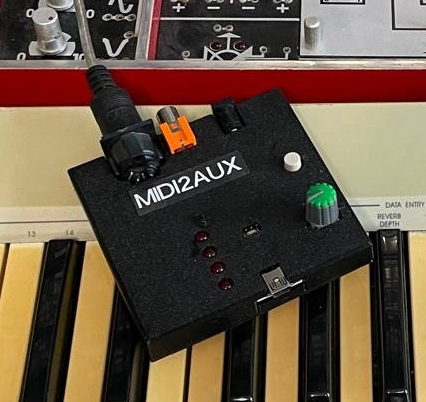
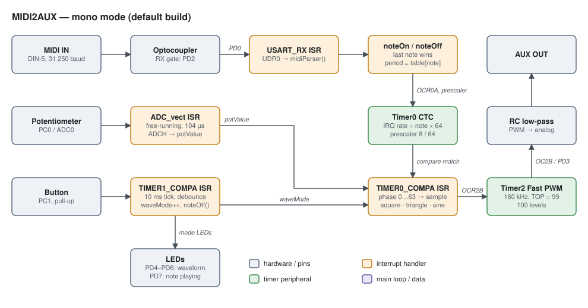
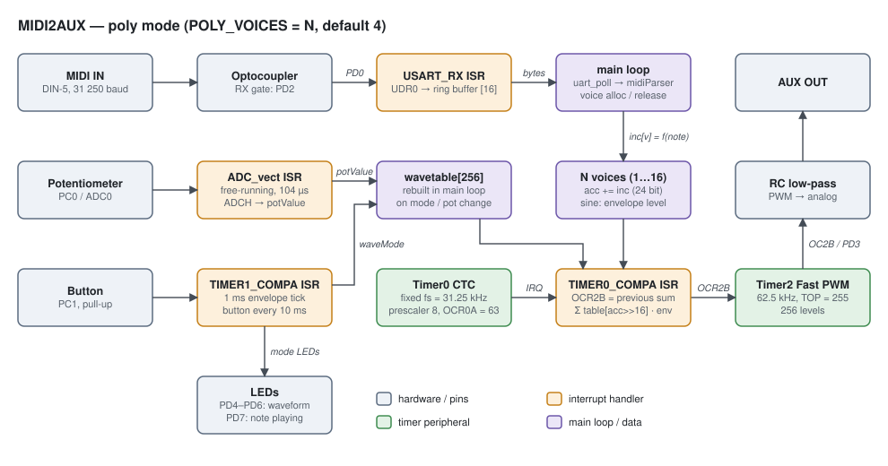

# MIDI→AUX Converter

Firmware for Arduino Nano (ATmega328P) that converts MIDI Note-On/Off messages into analog audio waveforms. Part of the АВК-6 «Музыкальная пауза» project.

## Hardware

| Pin | Function |
|-----|----------|
| PD0 | MIDI input (RX via optocoupler, 31250 baud) |
| PD2 | Optocoupler enable (active HIGH) |
| PD3 | Audio PWM output (OC2B → RC filter; 160 kHz mono, 62.5 kHz poly) |
| PC0 | Potentiometer (ADC0, 0–5V) |
| PC1 | Button (internal pull-up, mode switch + note off on press) |
| PD4 | LED — Square wave |
| PD5 | LED — Triangle wave |
| PD6 | LED — Sine wave |
| PD7 | LED — Note playing |

## Waveform Modes

| Mode | Waveform | Potentiometer effect |
|------|----------|---------------------|
| 0 | Square | Duty cycle (0–100%) |
| 1 | Triangle | Rise/fall split point (fully left/right = sawtooth) |
| 2 | Sine | None in the original build; with `SINE_ENV` — envelope character: pluck → organ → pad (see below) |

Short press the button to cycle modes. All notes are silenced on press.

## How It Works

The firmware has two build variants. Both use the same board and pins, and the same
PWM → RC output stage.

### Mono (default)



One note at a time; the last pressed note wins. The **sample rate itself is the pitch**:

1. A MIDI byte arrives on PD0 through the optocoupler. `USART_RX_vect` passes it
   straight to `midiParser()`.
2. On Note On, `noteOn()` takes the waveform period for the note from a 12-entry table
   (shifted per octave). It programs Timer0 in CTC mode so that the compare interrupt
   fires **64 times per period of the note**. Prescaler 8 or 64 is chosen by period length.
3. Each `TIMER0_COMPA` interrupt advances `phase` (0…63) and computes one sample of the
   current waveform. Square uses `potValue` as duty, triangle uses it as the split point,
   sine reads a 16-entry quarter-wave table. The sample goes to `OCR2B`.
4. Timer2 runs Fast PWM at 160 kHz (TOP = 99, 100 levels) on OC2B / PD3. The RC low-pass
   turns the duty cycle into an analog voltage on AUX OUT.
5. Note Off for the playing note (or the button, or MIDI Stop 0xFC) stops Timer0 and
   sets `OCR2B = 0`.

The ADC runs free and stores the potentiometer in `potValue`. The Timer1 tick debounces
the button, cycles `waveMode`, and updates the mode LEDs. PD7 is lit while a note plays.

Because Timer0 must interrupt at `note × 64`, high notes are clamped. A sample must not
be shorter than the waveform ISR, so the minimum period is 200 cycles for square and sine
(≈ 1250 Hz) and 350 cycles for triangle (≈ 714 Hz), whose ISR divides.

### Poly (`POLY_VOICES`, prototype)



`POLY_VOICES` simultaneous notes, set at compile time (1…16, default 4). Timer0 no
longer depends on the note: it **ticks at a fixed
31.25 kHz**, and each voice is a DDS phase accumulator.

1. `USART_RX_vect` only puts the byte into a 16-byte ring buffer (≈ 5 ms of MIDI). The
   main loop wakes after every interrupt, drains the buffer and runs `midiParser()`. That
   keeps the slow work (voice search, voice stealing) out of interrupt context.
2. Note On picks a voice in this order: the same note if it is already playing, then a
   free voice, then the oldest voice (stolen). It sets the voice's 24-bit phase increment
   `inc = f · 2²⁴ / fs`. Note Off releases the voice **by note number**.
3. All voices share one 256-byte `wavetable`. The main loop rebuilds it when the mode or
   the potentiometer changes, so duty and split control still work, and the interrupt
   never divides.
4. Each `TIMER0_COMPA` interrupt first writes the previous sum to `OCR2B`, so the output
   is jitter-free. Then for every active voice it does `acc += inc` and
   `sum += wavetable[acc >> 16]`.
5. Each voice's amplitude is `TOP / N`, so the sum never clips. Timer2 runs 8-bit Fast PWM
   at 62.5 kHz (TOP = 255), which gives 64 levels per voice for N = 4.

Cost: ≈ 77 + 30·N cycles per sample out of 512 (N = 4: 197 cycles, 38 % CPU; N = 8: 317
cycles, 62 %). The build fails if the sample ISR would exceed 90 % CPU. It warns above 70 %,
and also when a voice gets fewer than 16 PWM levels. At 31.25 kHz that means up to 12 voices
with a 24-bit accumulator. More voices cost resolution: per-voice levels = TOP / N + 1.
Pitch is exact (< 0.05 cent). The trade-offs against mono: a single note plays at ¼ of
full scale, high notes alias (fewer samples per period), and PWM ripple rises (62.5 kHz
instead of 160 kHz carrier). Full analysis: [docs/polyphony.md](docs/polyphony.md).

### Sine envelope (`SINE_ENV`)

In sine mode the potentiometer has nothing to control, so with `SINE_ENV` it sets the
amplitude envelope. One knob morphs smoothly between sound characters:

| Pot position | Character | Attack | While the key is held | After the key is released |
|---|---|---|---|---|
| 0 → 50 % | pluck / bell | 2 ms | decays to silence, 50 ms → 3 s | damped within 80 ms |
| 50 → 100 % | organ → pad | 2 ms → 1 s | sustains at 100 % | fades out, 50 ms → 2 s |

Times change exponentially along the knob. Decay and release are exponential curves;
times are to −40 dB. The other waveforms keep their pot functions (duty, split) and are
gated as before.

How it works:

- Timer1 ticks every 1 ms instead of 10 ms. The button logic runs on every 10th tick,
  so debouncing is unchanged.
- The main loop steps the envelope once per millisecond: linear attack, then
  `level = level · k >> 16` for decay and release. It recomputes the parameters (`expf`,
  `powf`) only when the pot moves by more than 4 steps.
- The sample ISR multiplies each sine sample by the 8-bit envelope level. Mono: +1 `mul`,
  the sine path is ≈ 126 cycles, under the 200-cycle minimum sample period. Poly: signed
  table, `mulsu` per voice, sum centred on mid-scale.
- Note Off starts the release. The voice (or the mono Timer0) keeps running until the
  envelope reaches silence. Re-pressing a held note retriggers its envelope without a
  phase reset.
- In sine mode the output idles at mid-scale instead of 0, so fades end without a DC step
  (click). The button and MIDI Stop still silence everything at once.

Poly cost with `SINE_ENV`: the sine path is ≈ 86 + 36·N cycles (N = 4: 230 cycles, 45 % CPU).
The other waveforms stay at ≈ 83 + 30·N. The budget check uses the sine path, so with
`SINE_ENV` the limit is 10 voices at 31.25 kHz.

Resolution limits how deep a fade sounds clean. The mono sine spans ±49 PWM levels, so at
−20 dB only ±5 levels remain and the tail turns grainy. Poly with N = 4 has ±31 per voice.

## Building & Upload

```bash
cmake -S . -B build          # avr-gcc from PATH, or -DAVR_TOOLCHAIN_DIR=/path/to/bin
cmake --build build          # all three targets below
cmake --build build --target upload_midi2aux_env   # avrdude, -DAVR_PORT=/dev/ttyUSB0
```

| Target | Firmware |
|---|---|
| `midi2aux` | Original mono, byte-identical to master |
| `midi2aux_env` | Mono + sine envelope on the pot (`SINE_ENV`) |
| `midi2aux_poly` | Poly; sine envelope on by default (`-DPOLY_SINE_ENV=OFF` to disable) |

Poly options: `-DPOLY_VOICES=1..16`, `-DPOLY_FS=31250`, `-DPOLY_PWM_TOP=255`,
`-DPOLY_ACC_BITS=24`, `-DPOLY_SINE_ENV=ON`. Prebuilt images are in [fw/bin/](fw/bin/). PlatformIO
(`pio run`) still builds the mono variant.

Remove MIDI jumper before upload — optocoupler gate (PD2) isolates RX.

## Architecture (mono)

Fully interrupt-driven. Main loop does nothing but sleep (`SLEEP_MODE_IDLE`).
In poly mode the main loop also parses MIDI and rebuilds the wavetable.

| Subsystem | Timer | Interrupt | Priority | Description |
|-----------|-------|-----------|----------|-------------|
| Button | Timer1 | `TIMER1_COMPA_vect` | **High** | 10 ms tick (1 ms with `SINE_ENV`, button every 10th), debounce 30 ms, calls `noteOff()` on press |
| Waveform | Timer0 | `TIMER0_COMPA_vect` | Low | Generates PWM sample at note × 64 Hz |
| Audio PWM | Timer2 | — | — | 160 kHz Fast PWM on PD3, OCR2B updated by waveform ISR |
| ADC | — | `ADC_vect` | — | Free-running, updates `potValue` every 104 µs |
| MIDI | — | `USART_RX_vect` | — | Calls `midiParser()` directly, no buffers |

### Timer0 Prescaler

| Period | Prescaler | OCR0A range |
|--------|-----------|-------------|
| < 2040 | 8 | 62–254 |
| ≥ 2040 | 64 | 32–238 |

Sample period clamped to ≥ 200 cycles (square, sine) or ≥ 350 cycles (triangle) to prevent ISR cascade on high notes.

### Memory

| Resource | Mono | Mono + `SINE_ENV` | Poly (default: 4 voices, `SINE_ENV`) |
|----------|------|------|-----------------|
| Flash | 2656 bytes (8.1%) | 4640 bytes (14.2%) | 5802 bytes (17.7%) |
| RAM | 74 bytes (3.6%) | 91 bytes (4.4%) | 827 bytes (40.4%) |

## Project Structure

```
CMakeLists.txt, cmake/avr-gcc.cmake   # CMake build (mono + poly)
platformio.ini                        # PlatformIO build (mono)
fw/src/
├── main.cpp          # init, sleep loop
├── uart.h / uart.cpp # MIDI UART (RX-only; poly: ring buffer)
├── midi.h / midi.cpp # Note period table, MIDI parser, noteOn/noteOff
├── waveform.h / waveform.cpp  # Mono: sine table, waveform ISR, 3 modes
├── poly.h / poly.cpp # Poly: DDS voices, wavetable, voice allocation
└── envelope.h / envelope.cpp  # SINE_ENV: pot-controlled sine envelope
fw/bin/               # Prebuilt .hex (mono, mono_env, poly4, poly4_env, poly1_env)
docs/polyphony.md     # Polyphony analysis and cycle budget
img/                  # Photo, block diagrams (SVG)
tools/isrcycles.py    # ISR cycle count from avr-objdump listing
```

---

*Project created with [KiloCode](https://github.com/Kilo-Org/kilocode) agent, model `deepseek/deepseek-v4-pro`.*
